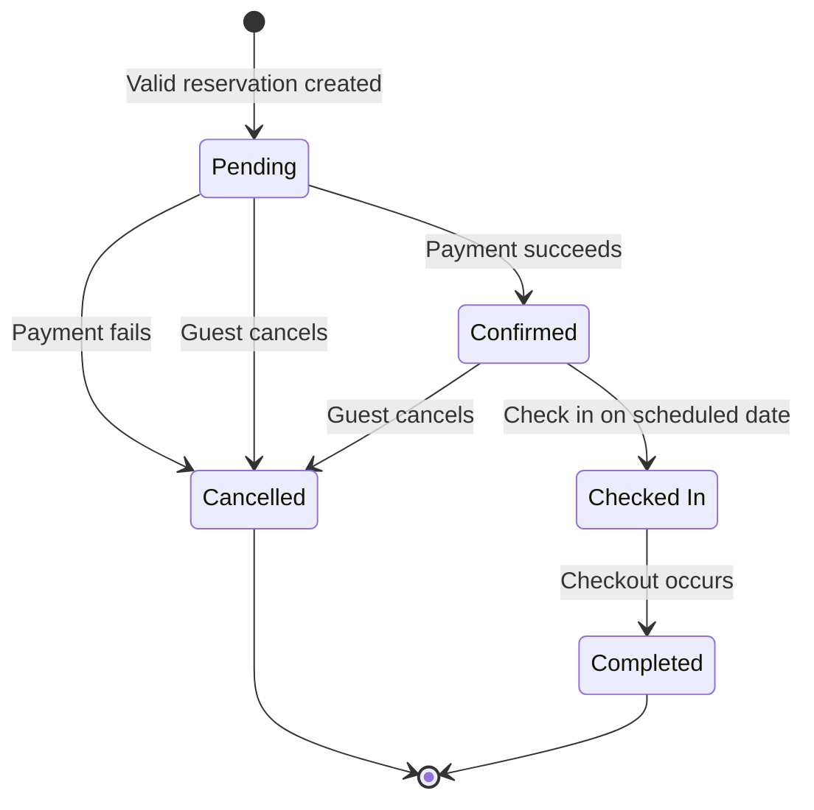

# Learning Practice 4: Black-Box Testing, Part 2

**Course:** AD361 H11 28561 — Fall 2026  
**Application:** North Vacation Booking  
**Date:** October 22, 2026

## Test basis and scope

North Vacation Booking lets hosts list vacation homes and guests make reservations. This test plan is based on the requirements in `StarterLP04.zip`, provided with the [Learning Practice assignment](https://canvas.seattlecolleges.edu/courses/46137/assignments/1020274).

No application code or running application was supplied. These are **designed test cases with expected results**, not executed tests. All cases have execution status **Not run**.

The plan covers reservation acceptance, pricing, reservation states, and invalid transitions. Payment processing internals, refunds, taxes, notifications, and authentication are outside the supplied requirements.

### Requirements used

| ID | Requirement |
|---|---|
| REQ01 | A reservation lasts 1–31 nights, inclusive. |
| REQ02 | A reservation has 1–12 guests, inclusive. |
| REQ03 | Base accommodation costs $200 per night. |
| REQ04 | Every valid reservation includes one $50 cleaning fee. |
| REQ05 | Each guest above five adds $25 per night. |
| REQ06 | Check-in precedes checkout; nights equal checkout minus check-in, excluding the checkout date. |
| REQ07 | Every reserved night must be available. |
| REQ08 | Invalid reservation information raises `ValueError`; unavailable dates raise `UnavailableError`. |
| REQ09 | A new valid reservation starts in `Pending`. |
| REQ10 | Payment success changes `Pending` to `Confirmed`; payment failure changes it to `Cancelled`. |
| REQ11 | A `Confirmed` reservation may become `Checked In` on its check-in date. |
| REQ12 | A `Checked In` reservation becomes `Completed` after checkout. |
| REQ13 | A `Pending` or `Confirmed` reservation may be cancelled. |
| REQ14 | `Cancelled` and `Completed` are terminal states. |
| REQ15 | Invalid state transitions raise `InvalidStateError`. |

### Conventions and assumptions

- Dates use `YYYY-MM-DD`. Test data represents calendar dates and whole-number guest counts; date parsing interfaces and time zones are not specified.
- A stay from November 1 through November 4 reserves the nights of November 1, 2, and 3. November 4 is not a reserved night.
- The decision table assumes input validation occurs before availability checking. The requirements do not define precedence when information is invalid and availability also fails. The concrete tests avoid that conflict; availability is not evaluated when a date range cannot be formed.
- Pricing is an expected quote, not a charge. Rejecting a request should not create a reservation or return a successful quote. Payment is a later state event.
- For checkout tests, the guest-checkout event takes place on the scheduled checkout date, after checkout has occurred. Exact checkout times and early-checkout policies are not specified or tested.
- The starter's Step 5 examples say cancelled dates are released. Where a test mentions release, it means the cancelled reservation no longer holds its previously reserved nights; it does not guarantee that another booking has not taken them. Pending inventory-hold timing is unspecified.
- An invalid transition is expected to preserve the current state while raising `InvalidStateError`. It should not silently advance or reopen the reservation.

## Step 1: Conditions and actions

### Five conditions

| ID | Condition | True when |
|---|---|---|
| C1 | Dates are valid | Both are valid calendar dates and check-in is before checkout. |
| C2 | Number of nights is valid | The calculated stay is between 1 and 31 nights, inclusive. |
| C3 | Number of guests is valid | The guest count is between 1 and 12, inclusive. |
| C4 | Requested nights are available | Every night from check-in up to, but excluding, checkout is available. |
| C5 | More than five guests | The guest count exceeds five. |

C1–C4 determine acceptance. C5 determines whether an accepted reservation needs the extra-guest charge; it does not independently make the reservation invalid.

### Five actions

| ID | Action | Expected behavior |
|---|---|---|
| A1 | Create reservation | Create one reservation in `Pending`. |
| A2 | Calculate standard price | Calculate `$200 × nights + $50`, including the cleaning fee once. |
| A3 | Add extra guest fee | Add `$25 × nights × (guests − 5)` when guests exceed five. |
| A4 | Raise `ValueError` | Reject invalid reservation information; do not create the reservation. |
| A5 | Raise `UnavailableError` | Reject otherwise valid information when at least one requested night is unavailable. |

For an accepted reservation, with `n` nights and `g` guests:

```text
standard price = 200 × n + 50
extra guest fee = 25 × n × max(g − 5, 0)
total price = standard price + extra guest fee
```

The extra fee applies only to guests above five, and the cleaning fee is added once per reservation.

## Step 2: Decision table

**T** = true; **F** = false; **-** = does not affect the result or is not evaluated; **X** = perform the action. An empty action cell means that action should not occur.

| Conditions and actions | R1 | R2 | R3 | R4 | R5 | R6 |
|---|:---:|:---:|:---:|:---:|:---:|:---:|
| C1: Dates are valid | T | T | F | T | T | T |
| C2: Number of nights is valid | T | T | - | F | T | T |
| C3: Number of guests is valid | T | T | - | - | F | T |
| C4: Requested nights are available | T | T | - | - | - | F |
| C5: More than five guests | F | T | - | - | - | - |
| **A1: Create reservation** | X | X |  |  |  |  |
| **A2: Calculate standard price** | X | X |  |  |  |  |
| **A3: Add extra guest fee** |  | X |  |  |  |  |
| **A4: Raise `ValueError`** |  |  | X | X | X |  |
| **A5: Raise `UnavailableError`** |  |  |  |  |  | X |

- **R1:** Accept a valid, available reservation with no extra-guest charge.
- **R2:** Accept a valid, available reservation and add the extra-guest charge.
- **R3:** Reject invalid, equal, or reversed dates.
- **R4:** Reject an ordered, valid date range whose length exceeds the permitted maximum.
- **R5:** Reject an out-of-range guest count.
- **R6:** Reject a valid request if any reserved night is unavailable.

This is a reduced table under the validation-precedence assumption above. C1 and C2 are related: equal or reversed dates already fail C1, while a stay of 32 nights has valid date order but fails C2. C5 cannot override an invalid guest count: 13 guests are rejected under R5, rather than priced under R2.

## Step 3: Decision-table test cases

**Common procedure:** reset the property's availability to the stated fixture, submit the listed check-in, checkout, and guest count, and inspect the result. For accepted cases, verify one `Pending` reservation and its complete price. For rejected cases, verify the specified exception, no new reservation, and no successful quote. Tests use a fresh request and independent fixtures.

The condition vector is ordered **C1, C2, C3, C4, C5**. `-` has the same meaning as in the decision table. Prices are USD. “All” means every requested night is available; blocked dates identify unavailable nights.

| Test | Rule | Conditions | Check-in → checkout | Nights | Guests | Availability | Expected action and price or exception |
|---|---|---|---|---|---|---|---|
| DT01 | R1 | T,T,T,T,F | 2026-11-01 → 2026-11-04 | 3 | 3 | All | A1+A2: create `Pending`; `3×200 + 50 = $650`. |
| DT02 | R2 | T,T,T,T,T | 2026-11-01 → 2026-11-04 | 3 | 6 | All | A1+A2+A3: create `Pending`; `600 + 50 + 3×1×25 = $725`. |
| DT03 | R3 | F,-,-,-,- | 2026-11-04 → 2026-11-01 | −3 | 3 | Not evaluated | A4: `ValueError`; check-in follows checkout. |
| DT04 | R4 | T,F,-,-,- | 2026-11-01 → 2026-12-03 | 32 | 3 | All | A4: `ValueError`; 32 nights exceeds the maximum. |
| DT05 | R5 | T,T,F,-,- | 2026-11-01 → 2026-11-04 | 3 | 0 | All | A4: `ValueError`; guest count is below the minimum. |
| DT06 | R6 | T,T,T,F,F | 2026-11-01 → 2026-11-04 | 3 | 3 | November 2 blocked; other requested nights available | A5: `UnavailableError`; one unavailable interior night rejects the entire request. |
| DT07 | R3 | F,-,-,-,- | 2026-11-01 → 2026-11-01 | 0 | 3 | Not evaluated | A4: `ValueError`; equal dates produce no reserved nights. |
| DT08 | R1 | T,T,T,T,F | 2026-11-01 → 2026-11-02 | 1 | 1 | All | A1+A2: create `Pending`; `1×200 + 50 = $250`. |
| DT09 | R2 | T,T,T,T,T | 2026-11-01 → 2026-12-02 | 31 | 12 | All | A1+A2+A3: create `Pending`; `31×200 + 50 + 31×7×25 = $11,675`. |
| DT10 | R5 | T,T,F,-,- | 2026-11-01 → 2026-11-04 | 3 | 13 | All | A4: `ValueError`; guest count exceeds the maximum, even though C5 would be true. |
| DT11 | R1 | T,T,T,T,F | 2026-11-01 → 2026-11-04 | 3 | 5 | All | A1+A2: create `Pending`; `$650`; five guests incur no extra fee. |
| DT12 | R2 | T,T,T,T,T | 2026-11-01 → 2026-11-04 | 3 | 12 | All | A1+A2+A3: create `Pending`; `600 + 50 + 3×7×25 = $1,175`. |
| DT13 | R1 | T,T,T,T,F | 2026-11-01 → 2026-11-04 | 3 | 3 | November 1–3 available; November 4 blocked | A1+A2: create `Pending`; `$650`; checkout-day unavailability must not reject the stay. |
| DT14 | R3 | F,-,-,-,- | 2026-02-30 → 2026-03-03 | Not calculable | 3 | Not evaluated | A4: `ValueError`; February 30 is not a valid calendar date. |
| DT15 | R6 | T,T,T,F,T | 2026-11-01 → 2026-11-04 | 3 | 6 | November 3 blocked; other requested nights available | A5: `UnavailableError`; the last reserved night is included in the availability check; no quote. |
| DT16 | R6 | T,T,T,F,F | 2026-11-01 → 2026-11-04 | 3 | 3 | November 1 blocked; other requested nights available | A5: `UnavailableError`; the first reserved night is included in the availability check. |

**Coverage:** all six rules have tests. Stay boundaries cover 0, 1, 31, and 32 nights; guest boundaries cover 0, 1, 12, and 13; the surcharge boundary covers 5 and 6. Availability checks cover the first, interior, and final reserved nights, plus exclusion of the checkout date. Multi-night prices check that the cleaning fee is charged once and the extra-guest fee is charged for each extra guest on each night.

## Step 4: Reservation states and events

### Five states

| State | Meaning |
|---|---|
| `Pending` | A valid reservation has been created and awaits payment. |
| `Confirmed` | Payment succeeded; the reservation awaits check-in or cancellation. |
| `Checked In` | The guest has checked in on the scheduled check-in date. |
| `Completed` | Checkout has occurred and the stay has ended; terminal state. |
| `Cancelled` | Payment failed or an eligible reservation was cancelled; terminal state. |

### Five events

| Event | Intended use |
|---|---|
| Payment succeeds | Confirm a `Pending` reservation. |
| Payment fails | Cancel a `Pending` reservation. |
| Guest cancels | Cancel a `Pending` or `Confirmed` reservation. |
| Guest checks in | Start the stay from `Confirmed` on the check-in date. |
| Guest checks out | Complete the stay from `Checked In` after checkout. |

Creating a reservation establishes the initial `Pending` state; it is not counted as one of the six valid transitions between the five reservation states.

## Step 5: State transition table

The valid checkout row assumes the checkout event described above. Date guards are part of a transition: being `Confirmed` alone is insufficient to check in on the wrong day.

| Transition | Current state | Event / guard | Expected state | Expected result | Type |
|---|---|---|---|---|---|
| TR01 | Pending | Payment succeeds | Confirmed | Confirm the reservation. | Valid |
| TR02 | Pending | Payment fails | Cancelled | Cancel; release any nights held by this reservation. | Valid |
| TR03 | Pending | Guest cancels | Cancelled | Cancel; release any nights held by this reservation. | Valid |
| TR04 | Confirmed | Guest checks in on the check-in date | Checked In | Record the guest as checked in. | Valid |
| TR05 | Confirmed | Guest cancels | Cancelled | Cancel; release this reservation's held nights. | Valid |
| TR06 | Checked In | Guest checks out; checkout has occurred | Completed | Complete the stay; enter a terminal state. | Valid |
| TR07 | Cancelled | Guest attempts to check in | Cancelled | Raise `InvalidStateError`; do not reopen. | Invalid |
| TR08 | Completed | Guest attempts to cancel | Completed | Raise `InvalidStateError`; preserve the completed state. | Invalid |
| TR09 | Pending | Guest attempts to check in | Pending | Raise `InvalidStateError`; confirmation is required first. | Invalid |
| TR10 | Confirmed | Guest attempts to check out without checking in | Confirmed | Raise `InvalidStateError`; cannot skip `Checked In`. | Invalid |
| TR11 | Checked In | Guest attempts to cancel | Checked In | Raise `InvalidStateError`; cancellation is permitted only from Pending or Confirmed. | Invalid |
| TR12 | Confirmed | Guest attempts to check in before the check-in date | Confirmed | Raise `InvalidStateError`; date guard fails. | Invalid |
| TR13 | Confirmed | Guest attempts to check in after the check-in date | Confirmed | Raise `InvalidStateError`; date guard fails. | Invalid |
| TR14 | Cancelled | Payment succeeds | Cancelled | Raise `InvalidStateError`; payment cannot reopen a terminal reservation. | Invalid |
| TR15 | Completed | Payment succeeds | Completed | Raise `InvalidStateError`; payment cannot reopen a terminal reservation. | Invalid |

The table contains **six valid and nine invalid transitions**. Other unlisted attempts are not permitted by this model; these selected invalid tests are not exhaustive coverage of every state/event combination.



The final markers indicate terminal states; they are not additional application states or reopen actions. Invalid transitions are documented in the table rather than drawn as successful arrows.

## Step 6: State transition test cases

### Common fixture and setup

Use an independent reservation for each atomic test: **check-in 2026-11-01, checkout 2026-11-04, three guests, all three reserved nights available, expected quote $650**.

Establish each starting state through valid actions:

- **Pending:** create the valid reservation.
- **Confirmed:** create it, then submit a successful payment result.
- **Checked In:** reach Confirmed, then check in on November 1.
- **Completed:** reach Checked In, then check out on November 4 after checkout has occurred.
- **Cancelled:** create it, then cancel while Pending. Repeat terminal-state tests using payment-failure and Confirmed-cancellation setup paths when broader coverage is needed.

**Procedure:** establish the listed starting state, set the event date, perform the listed event once, and assert both the final state and the result. For invalid cases, catch `InvalidStateError` and verify that the starting state remains unchanged. “Payment succeeds/fails” describes an external result; no payment-processing API is assumed.

### Atomic transition tests

| Test | Transition | Starting state | Event and date | Expected state | Expected result | Type |
|---|---|---|---|---|---|---|
| ST01 | TR01 | Pending | Payment succeeds, 2026-10-30 | Confirmed | No state error; reservation becomes confirmed. | Valid |
| ST02 | TR02 | Pending | Payment fails, 2026-10-30 | Cancelled | No state error; reservation is cancelled and any held nights are released. | Valid |
| ST03 | TR03 | Pending | Guest cancels, 2026-10-30 | Cancelled | No state error; reservation is cancelled and any held nights are released. | Valid |
| ST04 | TR04 | Confirmed | Guest checks in, 2026-11-01 | Checked In | No state error; check-in is accepted on the scheduled date. | Valid |
| ST05 | TR05 | Confirmed | Guest cancels, 2026-10-31 | Cancelled | No state error; this reservation releases its held nights. | Valid |
| ST06 | TR06 | Checked In | Guest checks out, 2026-11-04, after checkout | Completed | No state error; stay becomes completed. | Valid |
| ST07 | TR07 | Cancelled | Guest attempts check-in, 2026-11-01 | Cancelled | `InvalidStateError`; no reopening or check-in. | Invalid |
| ST08 | TR08 | Completed | Guest attempts cancellation, 2026-11-05 | Completed | `InvalidStateError`; completed state is preserved. | Invalid |
| ST09 | TR09 | Pending | Guest attempts check-in, 2026-11-01 | Pending | `InvalidStateError`, even though the date is correct. | Invalid |
| ST10 | TR10 | Confirmed | Guest attempts checkout, 2026-11-04 | Confirmed | `InvalidStateError`; check-in cannot be skipped. | Invalid |
| ST11 | TR11 | Checked In | Guest attempts cancellation, 2026-11-02 | Checked In | `InvalidStateError`; cancellation is not allowed from this state. | Invalid |
| ST12 | TR12 | Confirmed | Guest attempts check-in, 2026-10-31 | Confirmed | `InvalidStateError`; check-in is one day early. | Invalid |
| ST13 | TR13 | Confirmed | Guest attempts check-in, 2026-11-02 | Confirmed | `InvalidStateError`; check-in is one day late. | Invalid |
| ST14 | TR14 | Cancelled | Payment succeeds, 2026-10-31 | Cancelled | `InvalidStateError`; payment does not reactivate the reservation. | Invalid |
| ST15 | TR15 | Completed | Payment succeeds, 2026-11-05 | Completed | `InvalidStateError`; completed reservation remains terminal. | Invalid |

### ST16: Complete reservation sequence

**Starting point:** no reservation; common fixture and available nights.

| Step | Action | Expected state / result |
|---|---|---|
| 1 | Create the three-night reservation for three guests on 2026-10-30. | `Pending`; quote `$650`; cleaning fee included once. |
| 2 | Submit successful payment result on 2026-10-30. | `Confirmed` through TR01. |
| 3 | Check in on 2026-11-01. | `Checked In` through TR04. |
| 4 | Check out on 2026-11-04, after checkout has occurred. | `Completed` through TR06. |
| 5 | Attempt cancellation on 2026-11-05. | `InvalidStateError` through TR08; state remains `Completed`. |

**Pass criterion:** every intermediate state matches, the quote is correct, and the terminal-state attempt is rejected without changing the reservation state.

### ST17: Cancellation sequence

**Starting point:** no reservation; common fixture and available nights.

| Step | Action | Expected state / result |
|---|---|---|
| 1 | Create the reservation on 2026-10-30. | `Pending`; quote `$650`. |
| 2 | Submit successful payment result on 2026-10-30. | `Confirmed` through TR01. |
| 3 | Cancel on 2026-10-31. | `Cancelled` through TR05; the reservation releases its held nights. |
| 4 | Attempt check-in on 2026-11-01. | `InvalidStateError` through TR07; state remains `Cancelled`. |

**Pass criterion:** the reservation follows Pending → Confirmed → Cancelled and cannot be checked in afterward. Refund behavior is not asserted because it is not specified.

## Coverage and completion

| Required deliverable | Included |
|---|---|
| Five conditions and five actions | Step 1: C1–C5 and A1–A5. |
| At least six decision rules | Step 2: R1–R6. |
| At least one test per decision rule, with conditions, inputs, actions, and prices/exceptions | Step 3: DT01–DT16, with rule references. |
| Five states and five events | Step 4. |
| At least six valid and three invalid transitions | Step 5: six valid and nine invalid. |
| At least 11 state test cases | Step 6: 15 atomic tests and two sequence tests, 17 total. |
| Every valid transition covered | ST01–ST06 cover TR01–TR06. |
| Complete reservation sequence and cancellation sequence | ST16 and ST17. |

**Total:** 33 designed test cases: 16 decision-table tests and 17 state-transition/sequence tests. **Execution status: Not run — application implementation was not supplied.**
